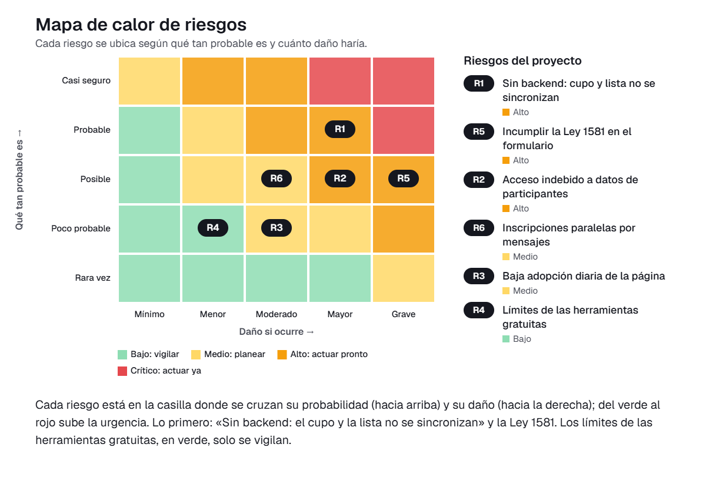

# 09 · Matriz de gestión de riesgos

En este documento identificamos y valoramos los riesgos de implementar en Valeria Daza Consulting la página web de registro, calificación y seguimiento de prospectos pyme. La v0.1 es una página sin servidor (sin backend), construida solo con herramientas gratuitas y con presupuesto de cero pesos. La usa a diario una única persona, Valeria Daza, desde su computador en casa. La página guarda por cada prospecto: empresa, contacto, tamaño, si el dueño decide rápido, presupuesto, estado del proceso y fecha de próximo seguimiento.

## Escala de valoración

- **Probabilidad (P):** de 1 (muy improbable) a 5 (casi seguro).
- **Impacto (I):** de 1 (insignificante) a 5 (severo).
- **Nivel = P × I:** 1-4 bajo, 5-9 medio, 10-16 alto, 20-25 crítico.
- **Responsables por rol:** LP, AP, UX y PR.

## Matriz de riesgos

| ID | Riesgo | Categoría | P | I | Nivel | Tratamiento | Acción | Responsable | Fecha |
|----|--------|-----------|---|---|-------|-------------|--------|-------------|-------|
| R1 | Recordatorio de seguimiento sin servidor: al no haber backend, la página solo puede avisar cuando Valeria la abre, y un seguimiento vencido pasaría inadvertido. | Tecnológico | 4 | 4 | 16 (Alto) | Mitigar | Mostrar al abrir la página un panel con los seguimientos de hoy y los vencidos, antes de la lista. Pedir a Valeria que registre además la fecha en el calendario de su celular como respaldo. | PR | 7 nov |
| R2 | Pérdida de datos guardados en el navegador: borrar el historial, cambiar de equipo o una falla del computador eliminaría la lista de prospectos. | Datos y ciberseguridad | 3 | 5 | 15 (Alto) | Mitigar | Agregar botones para exportar e importar la lista como archivo. Acordar con Valeria una copia semanal en una carpeta de almacenamiento en la nube gratuito protegida con contraseña. | PR | 10 nov |
| R3 | Abandono de la lista por Excel y WhatsApp: Valeria deja de actualizar la página y los prospectos vuelven a quedar regados. | Personas y adopción | 4 | 3 | 12 (Alto) | Mitigar | Dejar el registro en pocos campos, que se llene en menos de un minuto. Migrar los prospectos actuales a la página en una sesión con Valeria. Probar con prospectos reales y ajustar según lo que ella indique. | UX | 12 nov |
| R4 | Herramientas gratuitas con límites o cobro: el servicio de alojamiento puede cambiar sus condiciones y obligar a un gasto que no está presupuestado. | Financiero | 2 | 2 | 4 (Bajo) | Aceptar | Usar solo servicios con plan gratuito estable y mantener la página como archivos estáticos, que se pueden mover a otro alojamiento gratuito. Revisar las condiciones del servicio antes de la prueba. | AP | 14 nov |
| R5 | Datos personales sin autorización: se registran nombres y datos de contacto de personas recomendadas sin informarles el uso que se les dará, lo que contraviene la Ley 1581 de 2012. | Legal (Ley 1581 de 2012) | 3 | 4 | 12 (Alto) | Mitigar | Agregar a cada prospecto una casilla de autorización de tratamiento de datos. Redactar un aviso breve de privacidad que Valeria lee en la llamada de diagnóstico. Guardar solo los datos necesarios y permitir eliminar un prospecto cuando lo pida. | LP | 11 nov |
| R6 | Dependencia de una sola usuaria: si Valeria no puede usar la página unos días, nadie más puede consultar ni actualizar los prospectos. | Operativo | 2 | 3 | 6 (Medio) | Aceptar | Preparar una guía de una página con el uso básico de la página y mantener la copia exportada al día, para que otra persona pueda consultarla si hace falta. | AP | 14 nov |

## Riesgos altos y críticos: plan de respuesta

No identificamos riesgos críticos. Los cuatro riesgos altos son los que atendemos primero.

### R1 · Recordatorio de seguimiento sin servidor (nivel 16)

Este riesgo afecta directamente la hipótesis del prototipo, porque el objetivo es que ningún prospecto quede sin próximo seguimiento. Como la v0.1 no tiene servidor, no puede enviar avisos por sí sola. Por eso el panel de seguimientos de hoy y vencidos será lo primero que Valeria vea al abrir la página, y el calendario de su celular servirá de respaldo. El responsable es PR y el plazo es el 7 de noviembre. Lo damos por controlado cuando, en la prueba, cada seguimiento vencido aparezca en ese panel.

### R2 · Pérdida de datos guardados en el navegador (nivel 15)

La lista es el activo central de la solución, y perderla significaría volver al desorden que queremos eliminar. Al exportar e importar la lista en un archivo, Valeria puede recuperarla en cualquier equipo. La copia semanal en una carpeta en la nube con contraseña también protege la confidencialidad de los datos. El responsable es PR y el plazo es el 10 de noviembre. Lo damos por controlado cuando se pruebe una restauración completa desde el archivo exportado.

### R3 · Abandono de la lista por Excel y WhatsApp (nivel 12)

Valeria es la única usuaria y ya tiene hábitos de trabajo en Excel y WhatsApp. Si la página resulta lenta o incómoda, volverá a ellos. Reducimos los campos obligatorios, migramos juntos los prospectos actuales y ajustamos la pantalla según sus observaciones durante la prueba. El responsable es UX y el plazo es el 12 de noviembre. Lo damos por controlado cuando, al cierre de la prueba, ningún prospecto esté fuera de la página.

### R5 · Datos personales sin autorización (nivel 12)

Los prospectos llegan por recomendación, por lo que sus datos pueden registrarse antes de que la persona sepa que existen en una base. La Ley 1581 de 2012 exige informar la finalidad y contar con la autorización del titular. Por eso incorporamos el aviso de privacidad en la llamada de diagnóstico, la casilla de autorización por prospecto y la opción de eliminar registros. El responsable es LP y el plazo es el 11 de noviembre. Lo damos por controlado cuando todo prospecto con diagnóstico tenga la autorización registrada.

### Cómo leer el mapa de calor

Imagina una cuadrícula en la que cada riesgo está en la casilla donde se cruzan dos cosas: qué tan probable es que ocurra, de abajo hacia arriba, y cuánto daño haría si ocurre, de izquierda a derecha. Los colores van del verde, donde todo está tranquilo, al rojo, donde hay que actuar ya. En nuestro proyecto, lo más arriba y a la derecha quedó el **recordatorio de seguimiento sin servidor** y la **pérdida de datos guardados en el navegador**. Preocupan porque la página no tiene servidor y porque Valeria es la única usuaria: si el aviso no llega o la lista se borra, volvemos al problema de los prospectos que se pierden. Por eso lo primero que haremos es el panel de seguimientos vencidos y la copia exportable de la lista. Un escalón más abajo están el **abandono de la lista por Excel y WhatsApp** y los **datos personales sin autorización**, que resolvemos con un registro rápido y con el aviso de privacidad de la Ley 1581. En la zona verde quedaron las **herramientas gratuitas con límites o cobro**, porque la página se puede mover fácilmente a otro servicio gratuito, así que basta con revisar sus condiciones antes de la prueba.

## Conclusión

Los riesgos más importantes de la solución están en que el recordatorio y los datos dependen de una página sin servidor, y en que Valeria la adopte a diario. Con las acciones previstas antes del 18 de noviembre, dejamos controlados esos riesgos para la prueba con prospectos reales.
