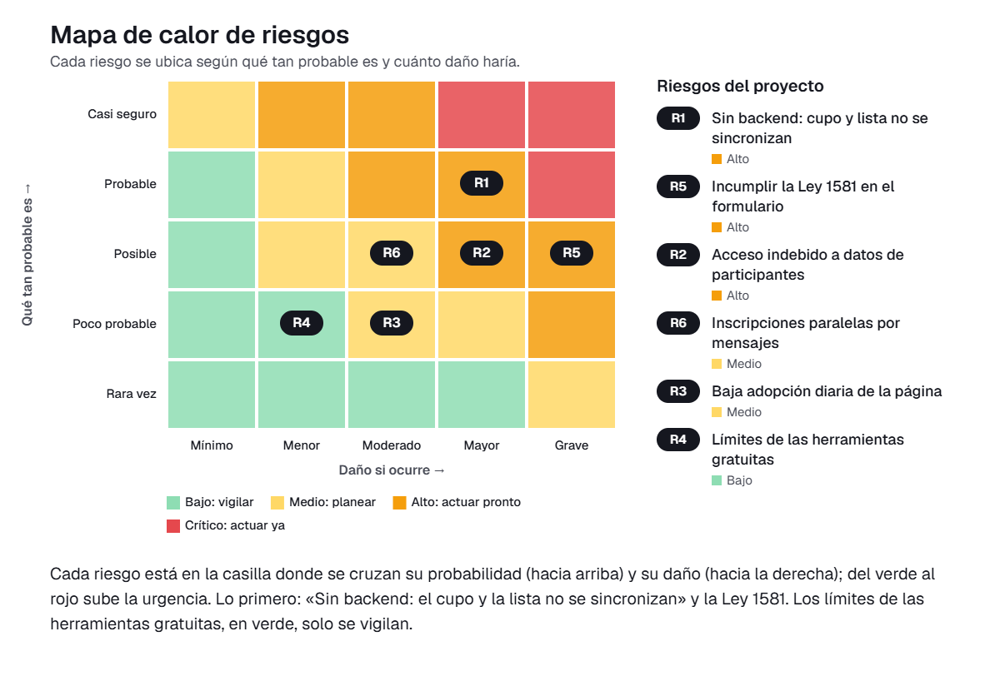

# 09 · Matriz de gestión de riesgos

En este documento identificamos y valoramos los riesgos de implementar en Valeria Daza Consulting nuestra solución: una página web con el formulario único de inscripción a los talleres grupales para MiPyMEs, accesible por enlace y código QR. La página registra al participante, descuenta el cupo en tiempo real y deja la lista única en el mismo lugar. La usará a diario Valeria Daza, fundadora y consultora, desde su computador en casa. La versión 0.1 es una página web sin backend, construida solo con herramientas gratuitas y con presupuesto de cero pesos.

Valoramos cada riesgo con probabilidad (P, de 1 a 5) por impacto (I, de 1 a 5). El nivel resulta de multiplicarlas: 1-4 bajo, 5-9 medio, 10-16 alto y 20-25 crítico.

## Matriz de riesgos

| ID | Riesgo | Categoría | P | I | Nivel | Tratamiento | Acción | Responsable | Fecha |
|----|--------|-----------|---|---|-------|-------------|--------|-------------|-------|
| R1 | Sin backend: el cupo y la lista no se sincronizan | Tecnológico | 4 | 4 | 16 · Alto | Mitigar | Guardar las inscripciones en un servicio gratuito compartido y no solo en el navegador. Cerrar el formulario al llegar al cupo máximo. Probar con inscripciones simultáneas simuladas y exportar la lista cada día como respaldo. | PR | 10 de noviembre |
| R2 | Acceso indebido a datos de participantes | Datos y ciberseguridad | 3 | 4 | 12 · Alto | Mitigar | Mostrar la lista completa solo a Valeria, con clave de acceso, y no en la vista pública. Pedir solo los datos indispensables y guardar una copia de respaldo en una cuenta protegida con verificación en dos pasos. | PR | 12 de noviembre |
| R3 | Baja adopción diaria de la página | Personas y adopción | 2 | 3 | 6 · Medio | Mitigar | Hacer una sesión de práctica con Valeria usando un taller de ejemplo. Entregar una guía de una página y recoger sus ajustes antes de la prueba. | UX | 7 de noviembre |
| R4 | Límites de las herramientas gratuitas | Financiero | 2 | 2 | 4 · Bajo | Aceptar | Revisar los límites de uso de las herramientas elegidas y mantener el respaldo exportable. Si se superan, migrar la lista a otra herramienta gratuita sin gasto. | LP | 6 de noviembre |
| R5 | Incumplir la Ley 1581 en el formulario | Legal (Ley 1581 de 2012) | 3 | 5 | 15 · Alto | Mitigar | Incluir en el formulario el aviso de privacidad, la finalidad del tratamiento y la casilla obligatoria de autorización previa. Indicar el canal para consultar, corregir o eliminar datos y no recoger datos sensibles. | AP | 8 de noviembre |
| R6 | Inscripciones paralelas por mensajes | Operativo | 3 | 3 | 9 · Medio | Mitigar | Responder a quien escriba por mensaje con el enlace o el QR del formulario y no transcribir inscripciones a mano. Revisar la lista cada día para detectar duplicados y ajustar el cupo. | LP | 14 de noviembre |

## Riesgos altos y críticos

No identificamos riesgos críticos. Los tres riesgos altos son los que tratamos primero.

### R1 · Sin backend: el cupo y la lista no se sincronizan (nivel 16, alto)

La v0.1 no tiene servidor propio. Si dos personas se inscriben a la vez o Valeria abre la página desde otro equipo, el cupo podría quedar mal descontado o la lista podría no coincidir. Esto repetiría el problema que queremos resolver: cupos mal controlados y listas que se pierden.

- **Plan:** guardar las inscripciones en un servicio gratuito compartido, de modo que la lista sea una sola. Cerrar el formulario cuando se llegue al cupo máximo y probar inscripciones simultáneas con datos de ejemplo.
- **Respaldo:** exportar la lista una vez al día.
- **Responsable y fecha:** PR, 10 de noviembre.

### R5 · Incumplir la Ley 1581 en el formulario (nivel 15, alto)

El formulario recoge nombre, contacto y datos de la empresa de los participantes. Sin aviso de privacidad ni autorización previa, Valeria Daza Consulting incumpliría la Ley 1581 de 2012. Eso podría traerle reclamos, sanciones y pérdida de confianza entre sus clientes.

- **Plan:** agregar al formulario el aviso de privacidad con la finalidad del tratamiento y una casilla obligatoria de autorización, sin la cual no se envía la inscripción. Publicar el canal para consultar, corregir o eliminar datos y pedir solo los datos necesarios para el taller.
- **Responsable y fecha:** AP, 8 de noviembre.

### R2 · Acceso indebido a datos de participantes (nivel 12, alto)

La lista única vive en la misma página que se comparte por enlace y QR. Si no separamos la vista pública de la vista de Valeria, cualquiera con el enlace podría ver los datos de otros participantes.

- **Plan:** proteger la lista con clave de acceso para que solo Valeria la vea y dejar pública únicamente la pantalla de inscripción. Mantener un respaldo en una cuenta con verificación en dos pasos y revisar quién tiene acceso a las herramientas.
- **Responsable y fecha:** PR, 12 de noviembre.

### Cómo leer el mapa de calor

Cada riesgo aparece en la casilla donde se cruzan dos cosas: qué tan probable es, de abajo hacia arriba, y cuánto daño haría si ocurre, de izquierda a derecha. El color va del verde, donde se puede estar tranquilo, al rojo, donde hay que actuar ya. En nuestro proyecto lo más arriba y a la derecha quedaron «Sin backend: el cupo y la lista no se sincronizan» y «Incumplir la Ley 1581 en el formulario». Preocupan porque, sin servidor propio, un cupo mal descontado repetiría justo el problema de los talleres. Además, el formulario recoge datos personales de los participantes de Valeria Daza Consulting. Por eso lo primero será dejar una lista única compartida y añadir el aviso de privacidad con la autorización previa. Cerca de ese grupo queda «Acceso indebido a datos de participantes», que atenderemos con la clave de acceso a la lista. En la zona verde está «Límites de las herramientas gratuitas», que basta con vigilar porque el presupuesto es de cero pesos y tenemos un respaldo exportable para migrar si hace falta. «Baja adopción diaria de la página» e «Inscripciones paralelas por mensajes» quedaron en medio, y las atenderemos con práctica con Valeria y con el enlace y el QR como único canal de inscripción.

## Conclusión

Nuestros riesgos más serios están en la lista única de la v0.1 y en el tratamiento de datos personales, y los atendemos antes del 18 de noviembre con acciones sin costo.
Con un respaldo diario, acceso restringido a la lista y la autorización de datos en el formulario, Valeria podrá coordinar los talleres con cupos confiables y dentro de la ley.

